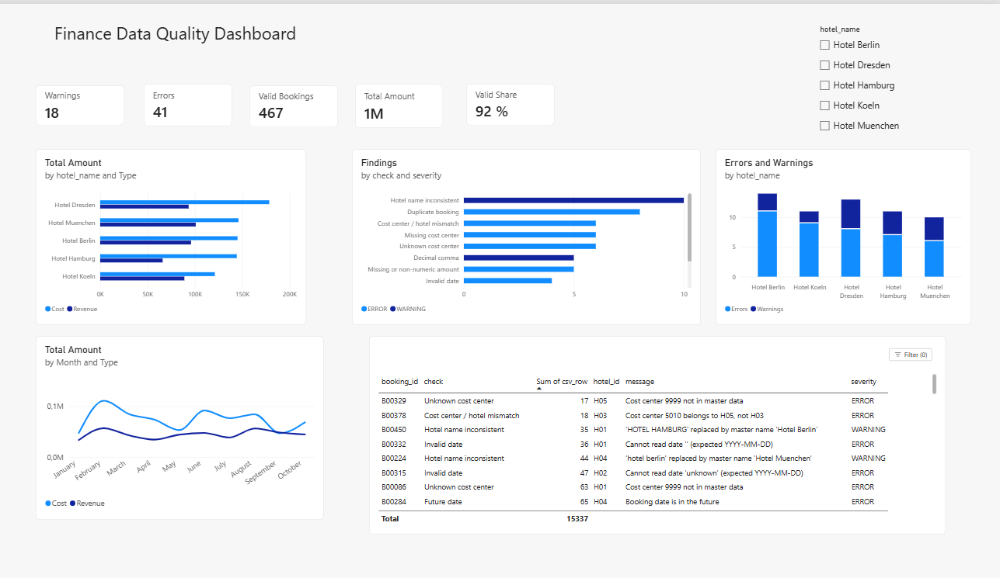

# Finance Data Quality Checker

A small Python project that validates a (synthetic) hotel-group booking export,
finds typical data errors, reconciles totals and produces an Excel error report.
It mirrors everyday finance-system work: master data checks, error handling,
reporting and small automations.

> All data is **synthetic**, generated by `generate_data.py`. No real company data is used.

## What it does
1. `generate_data.py` creates ~500 fake bookings for 5 fictional hotels and injects errors
   (duplicates, missing/unknown cost centers, wrong hotel assignment, inconsistent
   names, invalid/future dates, missing/zero/extreme amounts, decimal commas).
2. `validate_bookings.py` checks every row against master data, classifies findings as
   ERROR or WARNING, builds a clean dataset, compares monthly totals per hotel with
   control totals and exports `output/validation_report.xlsx`.
3. `sql_analysis.py` loads the clean data into SQLite and answers business questions with SQL
   (JOINs, GROUP BY, aggregation).

## Checks implemented
| Check | Severity |
|---|---|
| Duplicate booking / booking ID | ERROR |
| Missing cost center | ERROR |
| Unknown cost center | ERROR |
| Cost center belongs to a different hotel | ERROR |
| Invalid or future date | ERROR |
| Missing / non-numeric amount | ERROR |
| Amount above 100,000 EUR (outlier) | ERROR |
| Hotel name differs from master data (auto-corrected) | WARNING |
| Decimal comma converted | WARNING |
| Zero amount | WARNING |

## Run it
```bash
pip install -r requirements.txt
python generate_data.py
python validate_bookings.py
python sql_analysis.py
```

## Dashboard


## Example result
508 raw rows -> 41 rows with errors -> 467 clean rows; 18 warnings;
25 hotel/month combinations did not match the control totals.

## Tech
Python 3, pandas, openpyxl, SQLite (sqlite3), SQL

## Ideas for next steps
- Read the booking export directly from a database instead of CSV
- Add a simple dashboard in Power BI on top of `clean_bookings.csv`
- Send the error report to the responsible hotel automatically
